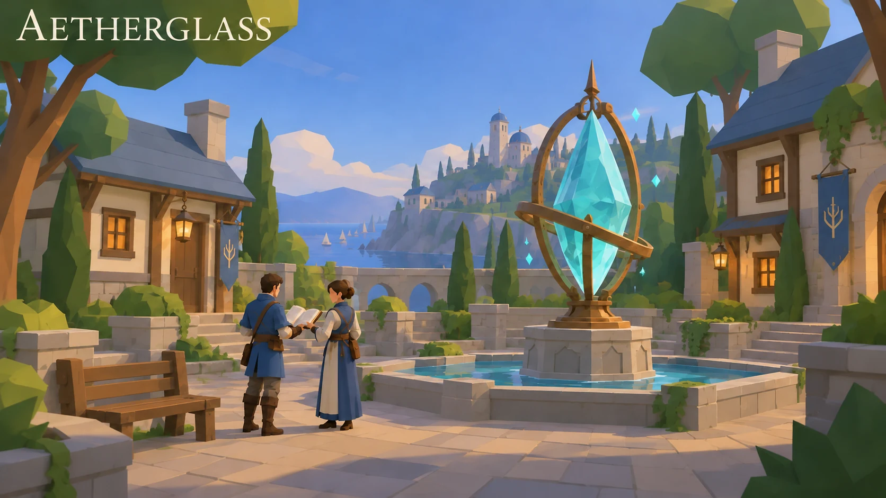
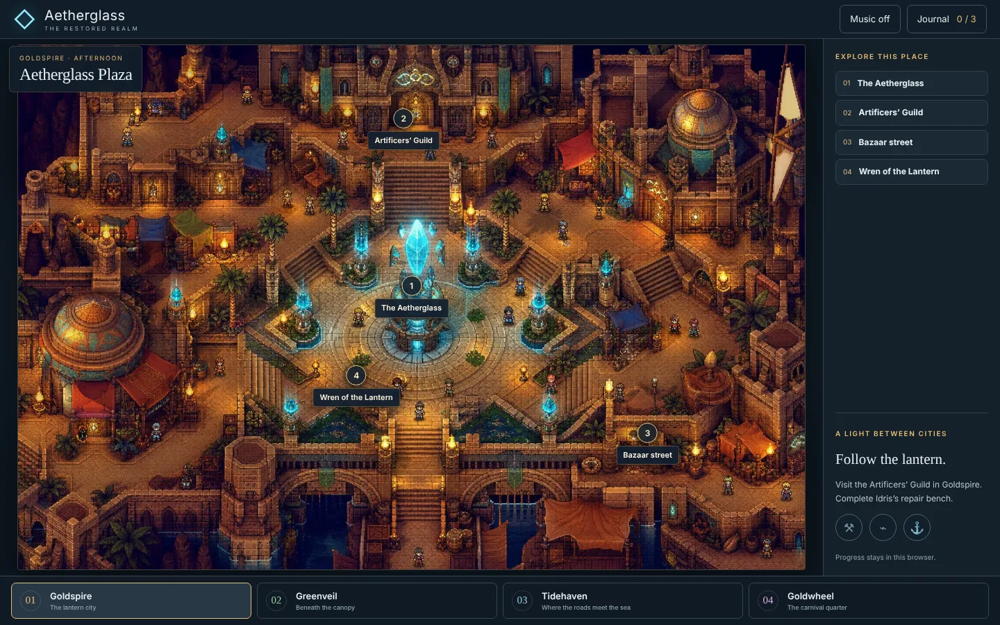
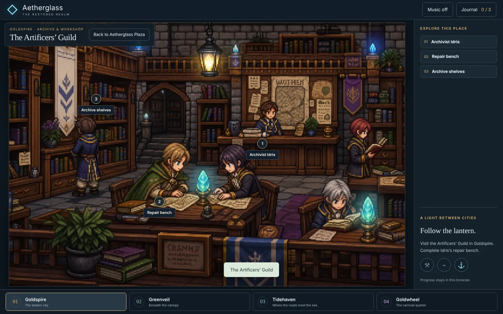
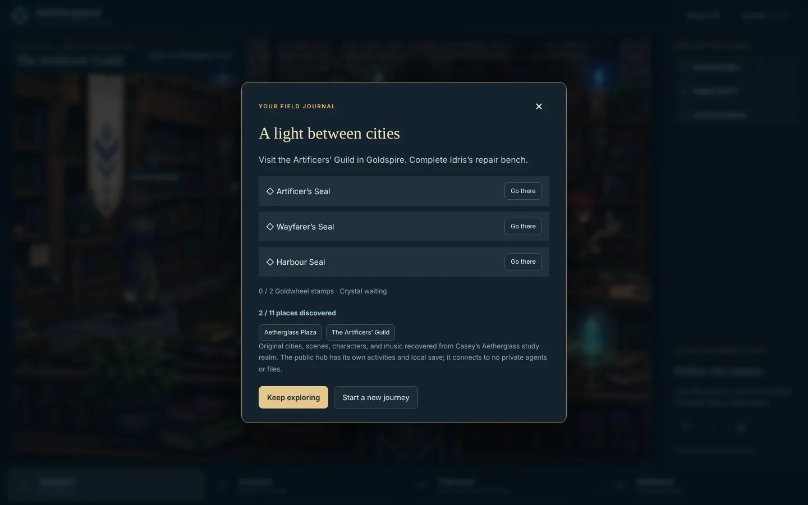
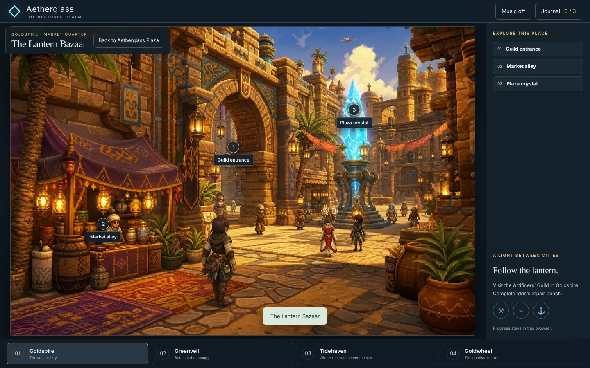

# Aetherglass

**An interactive hub for the restored realm: travel, talk and play.**

[**▶ Live demo**](https://beebopcat.github.io/aetherglass/) · [**Play on caseyshingledecker.com**](https://caseyshingledecker.com/demos/aetherglass/) · [**Source**](https://github.com/Beebopcat/aetherglass)

[](https://beebopcat.github.io/aetherglass/)

*Promotional cover art; gameplay screenshots appear below.*

> **Status:** the game files are being added to this repository. Until `index.html` is at the repository root, the GitHub Pages link above has nothing to show; the same game is playable on caseyshingledecker.com.

## What it is

An interactive hub for the restored realm. Travel between original cities, enter buildings, talk to characters, and play three guild study challenges and the Goldwheel games.

## Screenshots

| | |
|:--:|:--:|
|  |  |
| <sub>Aetherglass Plaza: an afternoon fantasy plaza with numbered place markers and the Explore this place list.</sub> | <sub>The Artificers' Guild interior, a lantern-lit archive workshop with a Back to Aetherglass Plaza button and place markers.</sub> |
|  |  |
| <sub>Field journal dialog titled A light between cities, listing the Artificer's Seal, Wayfarer's Seal and Harbour Seal.</sub> | <sub>The Lantern Bazaar, a market street with a glowing plaza crystal and markers labelled Guild entrance and Market alley.</sub> |

### Video

[](docs/media/clip.mp4)

*Click the poster to open the short screen recording (docs/media/clip.mp4).*

## How to use

1. Open the hub and click spots in each scene to travel, talk, read lore or start a challenge.
2. Earn the three study seals (Artificers, Wayfarers and Harbour) and restore the Aetherglass crystal in Goldspire.
3. Use Music on/off, the Journal (shown as 0/3 at the start) and Labels on. Progress is saved in your browser (localStorage).

### Quick start


<sub>Field journal dialog titled A light between cities, listing the Artificer's Seal, Wayfarer's Seal and Harbour Seal.</sub>

## Features

- Four cities: Goldspire (lantern city), Greenveil (beneath the canopy), Tidehaven (where the roads meet the sea) and Goldwheel (carnival quarter)
- Scenes such as Aetherglass Plaza, Lantern Bazaar, Artificers' Guild, Crystal Market, Canopy Commons, Lantern Walk, Wayfarers' Lodge, Bluewater Quay, Harbour Watch, Carnival Quarter and Goldwheel Hall
- Characters including Wren of the Lantern, Archivist Idris, the Tip Owl, a crystal merchant and an evening host
- Three guild challenges (repair bench, route table, dockside ledger) and the Goldwheel games Crystal pairs and Lantern sequence, with no wagers
- Original music-box score

## The story behind it

Place names, characters and art were recovered from earlier studio work. The public demo encounters are independent of any private study or agent tooling. The art grows out of FFXIV-inspired fan concept art.

## Built with

- HTML
- ES modules (hub, world, engine and music modules)
- Web Audio

## Run it locally

This is a static web project, so any local web server works:

```bash
git clone https://github.com/Beebopcat/aetherglass.git
cd aetherglass
python -m http.server 8000
```

Then open http://localhost:8000 in your browser.

## Credits & disclaimers

The art grows out of FFXIV-inspired fan concept art. This is fan-inspired work with original place names and characters; it is not affiliated with or endorsed by Square Enix.

Built by Casey Shingledecker with AI-assisted development.

## More projects

- Portfolio and live demos: https://caseyshingledecker.com/
- All repositories: https://github.com/Beebopcat

## License

Copyright (c) 2026 Casey Shingledecker. All rights reserved. Source-available for viewing and for personal, non-commercial running only; this is not open source. See [LICENSE](LICENSE). See also [NOTICE.md](NOTICE.md). Other people's material keeps its own license.
